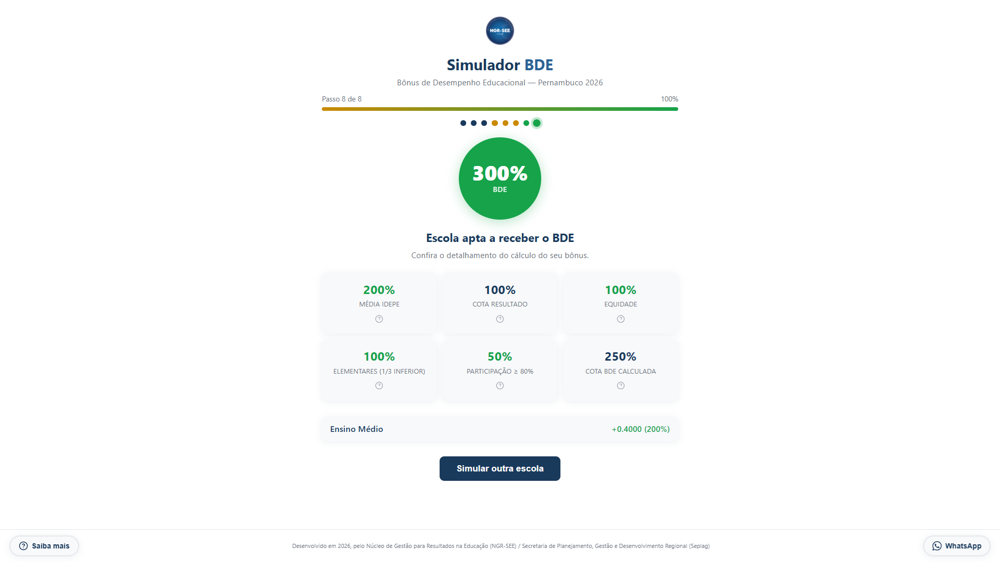

# Simulador BDE — NGR-SEE



Sistema interativo para simulacao do Bonus de Desempenho Educacional (BDE) de Pernambuco.

## O que e?

O Simulador BDE foi desenvolvido pelo Nucleo de Gestao para Resultados na Educacao (NGR-SEE) / Seplag para facilitar a vida dos gestores escolares. Antes, o calculo do BDE era feito manualmente em planilhas Excel. Agora, basta preencher os dados em um passo a passo guiado e o sistema faz todo o calculo automaticamente.

## Funcionalidades

- **Wizard passo a passo**: navegacao intuitiva em etapas
- **Calculo automatico**: formula exata da planilha original
- **Resultado detalhado**: visualizacao de cada componente do BDE
- **Explicacoes interativas**: clique nos cards do resultado para entender cada metrica
- **Contato integrado**: WhatsApp para suporte

## Como executar

```bash
cd "D:\exemplo\mudar-caminho"
python -m uvicorn main:app --reload
```

Acesse: http://127.0.0.1:8000

## Publicacao (Google Sites / GitHub Pages)

O `index.html` na raiz e a mesma interface sem servidor: os tres arquivos de
`app/` reunidos, com o calculo em JavaScript no lugar da chamada a API. E o que
o GitHub Pages serve em https://monkius-maximus.github.io/bdengroutubro/ e o
que o Google Sites embute.

Mexeu em `app/`? Regenere e rode os testes:

```bash
python3 tools/gerar_index.py
python3 tests/test_paridade.py
python3 tests/test_cenarios.py
```

A regra do BDE vive em dois lugares — `src/bde/service.py` e
`app/static/js/motor.js`. Mudou num, mude no outro: `test_paridade.py` compara
os dois campo a campo e `test_cenarios.py` confere a tabela da regra.
Passo a passo em [`docs/GOOGLE_SITES.md`](docs/GOOGLE_SITES.md).

## Stack

- **Backend**: FastAPI + Python
- **Frontend**: HTML + CSS + JavaScript vanilla
- **Templates**: Jinja2

## Simulador IDEB (`ideb/`)

Segunda aplicação sobre o mesmo front-end: reaproveita o `estilo.css`, o logo,
o rodapé, os popups e o fluxo do wizard do BDE. Porta a aba "Simulador Ideb"
da planilha do Núcleo da Seplag: IDEB = N × P por etapa, com P a média
harmônica das aprovações e N a média de LP e MT padronizadas pelos limites do
SAEB 1997. Estática, sem backend: https://monkius-maximus.github.io/bdengroutubro/ideb/

- `ideb/motor.js` — o cálculo, sem DOM
- `ideb/wizard.js` — navegação e telas
- `ideb/ideb.css` — só o que o `estilo.css` do BDE não tem

`tests/test_ideb.py` confere o motor contra valores calculados pela própria
planilha. Para levar a outro repositório, copie `ideb/`, `app/static/css/estilo.css`
e `app/static/img/logo-ngr.png` e ajuste os caminhos `../app/static/`.
